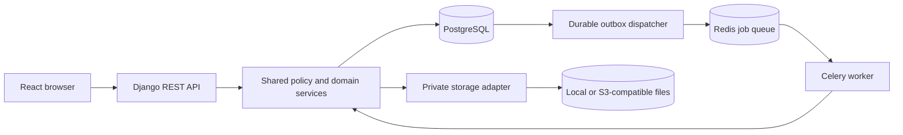

# Architecture and repository structure

Status: contracts accepted in S001 on 2026-10-05; S002 implements the backend
foundation in `backend/config/` with development/test/production settings and
`/api/health`. The accepted [ADRs](docs/decisions/README.md) agree with SRS 1.1.
Python dependencies are pinned in `uv.lock`, with checks in `backend/tests/`.
S003 supplies `frontend/src/app/` (router/shell), `components/` (accessible
primitives), `lib/api.ts` (session/CSRF client), and a development-only showcase
under `features/development/`. npm dependencies are pinned in
`frontend/package-lock.json`; component/client tests sit beside source, and real
browser checks live in `frontend/e2e/`. S004 adds Compose PostgreSQL/Redis services,
the Vite-to-Django development proxy and `.github/workflows/ci.yaml`. Application
processes run on the host; persistent dependency data uses project-scoped Docker
volumes outside the checkout. S005 implements `backend/apps/accounts/` with the
custom User, profile, fixed role assignments and account-state predicates. Other
business modules remain assigned to later sprints. S006 adds `backend/apps/audit/`
for transactional immutable records, reviewed payload projections and protected
paginated reads; [audit.md](docs/audit.md) defines the feature integration contract.
S007 adds `backend/apps/access/` for current role/state checks, registered queryset
policies, typed resource references, scoped grants and audited privilege commands.
[access.md](docs/access.md) defines adapter and transaction-locking contracts.
S008 adds `accounts/auth/` and `frontend/src/features/auth/` for database sessions
and account UI. S009 adds `accounts/registration/` for pending Student creation,
single-use verification and post-commit mail delivery. Verification challenge
digests live in PostgreSQL; raw tokens appear only in mail and transient memory.
S010 adds `accounts/recovery/` for password changes, reset challenges and audited
admin lifecycle commands. They share the privilege lock and revoke subject sessions
inside the mutation transaction; see [recovery-lifecycle.md](docs/recovery-lifecycle.md).
S011 adds `accounts/api/` and `frontend/src/features/accounts/` for admin
list/detail/create, reviewed role/lifecycle changes, restricted own-profile editing
and dedicated single-use invitations. The API calls existing authorization, role
and lifecycle services; see [account-management.md](docs/account-management.md).
S012 adds `apps/academics/structure/` and `frontend/src/features/academics/` for
departments, batches, terms and sections. Protected typed parents, scoped label
uniqueness, archive gates and reviewed admin mutation use existing authorization
and audit. Future assignment writers must reuse the atomic context validation
described in [academic-structure.md](docs/academic-structure.md).
S013 adds `academics/courses/` and `frontend/src/features/courses/` for the reusable
department course catalog. Administrator mutations share privilege locking and audit;
Teacher read projections exclude archived courses/departments. Courses have no term
or batch FK. See [course-catalog.md](docs/course-catalog.md) for the transaction
boundary future offering writers must use.
S014 adds `academics/offerings/` and `frontend/src/features/offerings/` for scoped
offering creation/settings and admin-managed multiple teacher assignments. Matching
academic tuples and immutable authorship/history are enforced in PostgreSQL; writes
share authorization, revision, privilege-lock and audit boundaries. The Offering
policy registers `course.view`/`course.manage`; membership never implies Contest
authority. See [offerings](docs/offerings.md) for the implemented contract.
The real browser suite in `frontend/e2e-auth/` uses isolated databases and a
temporary test mailbox. See [registration.md](docs/registration.md).

## Required documentation layout

```text
AArchive/
├── README.md
├── AGENTS.md
├── ARCHITECTURE.md
├── TASKS.md
├── CONTRIBUTING.md
├── .env.example
├── .gitignore
├── docs/
│   ├── requirements.md
│   ├── api.md
│   ├── database.md
│   ├── security.md
│   ├── decisions/
│   │   └── README.md
│   ├── archive-layout.md
│   ├── archive-contract.md
│   └── progress.md
└── scripts/
    └── sprint_context.py
```

This is the project owner's requested documentation structure, with the archive
contract, sprint status, and context helper added for handoff. New ADRs belong in
`docs/decisions/NNNN-short-title.md`. New operational guides belong in
`docs/runbooks/` when their sprints create them.

## Application layout to create during implementation

```text
backend/
├── manage.py
├── config/                  # Settings, URLs, worker configuration
└── apps/
    ├── accounts/            # Platform identity, login, lifecycle
    ├── audit/               # Append-only audit and durable event outbox
    ├── academics/           # Departments, batches, courses, offerings, enrollment
    ├── access/              # Roles, scoped grants, groups, visibility policies
    ├── assets/              # Storage adapters, classification, authorized delivery
    ├── contests/            # Immutable source versions, archive queries, overlays
    ├── imports/             # Upload, staging, validation, mapping, commit, recovery
    ├── grading/             # Assessments, rules, marks, history, publication
    ├── reports/             # Scoped datasets, aggregates, export formats/jobs
    ├── notifications/       # Platform event delivery and inbox
    └── governance/          # Settings, trash, purge, anonymization, operations
frontend/
└── src/
    ├── app/                 # Router, application shell, session boundary
    ├── components/          # Accessible shared controls
    ├── features/            # Feature pages organized by domain
    └── lib/                 # API client and small shared utilities
tests/
├── fixtures/                # Tiny redistributable synthetic data
├── integration/
├── security/
└── performance/
deploy/                      # Production configuration and runbook scripts
.github/workflows/           # CI gates
```

These directories are created when needed. Avoid empty feature scaffolds that
look like completed functionality. Tests may live beside a Django app or frontend
feature; cross-domain suites belong in the shared test areas. S002-S004 document
the exact chosen test layout and commands. The S002 foundation uses `backend/tests/`
for settings/health checks and S005 adds PostgreSQL account tests there. Accounts
uses Django's `AbstractBaseUser`, with `AUTH_USER_MODEL=accounts.User` created by
`accounts.0001_initial`. S008 installs Django auth/contenttypes/sessions for database-backed authentication;
the admin application is not installed. No default `auth_user` table is created.
Framework Group/Permission tables confer no platform authority; the custom backend
does not use them or a separate superuser flag as a second platform-role system. S007
implements audited changes to the three platform roles and scoped grants.

## Runtime boundaries

The backend is one modular monolith with a worker sharing the same codebase and
database. React consumes the same-origin REST API. Use Django sessions and CSRF.
PostgreSQL owns structured records and constraints. S3-compatible object storage
owns file bytes, with a local adapter for development. Redis supports background
jobs and optional caches; it is not the authoritative grade or archive store.



Module code uses domain services for mutations. REST views, workers, admin tools,
and management commands must not independently recreate permission or grading
rules. Keep pure calculations independent of HTTP and storage; put transaction
boundaries around business operations, not around each row in an import.

## Import and evidence boundaries

Upload and extract into staging; validate paths/limits, manifest, trusted schemas,
checksums, references, and counts; resolve identity mappings; present a revisioned
preview; explicitly confirm; publish the complete version transactionally.
Required assets become durable before the database exposes their references.
Retries reconcile orphaned objects and event delivery using idempotent services.

The owner-supplied [ZIP tree](docs/archive-layout.md) describes incoming evidence.
Its `contest/`, `people/`, and `files/` folders are not application source modules.
The real field contract is onboarded in S025; do not invent concrete source fields
in a production adapter based on comments in the tree.

Source records belong to immutable import versions. University mappings, notes,
visibility, and grades belong to separate models. Re-import changes the current
source-version pointer without changing academic values. Explicit grade
re-application is a later audited action with its own permissions and preview.

Contest identity uses a verified namespace and stable contest key. Repeated jobs
deduplicate against committed versions by contest and ZIP digest; replaying an old
payload cannot roll back the current pointer. Job status, source-version status,
and contest lifecycle are separate. Accounts owns the narrowly authorized pending
Student provisioning command; importer code never assigns platform roles.

Offerings may share a Contest but own independent assessments. Offering teachers
grade their assessments; global contest changes require explicit contest assignment.
Without an explicit component override, shared-offering visibility intersects the
applicable defaults. SRS Section 10 defines the common privacy matrix.

## Working conventions

- Pin supported dependency versions and lockfiles in the foundation sprints.
- Store timestamps consistently and preserve source timezone/unit metadata.
- Use Decimal for grades and documented integer/decimal units for source scores.
- Share scoped dataset projections between screens and CSV/XLSX/PDF outputs.
- Make schema trust, data availability, version, publication state, and current
  requester scope explicit inputs to the relevant services.
- Store architecture changes in an ADR and update affected API/database/security
  contracts and sprint dependencies. Avoid choosing a new stack per sprint.
