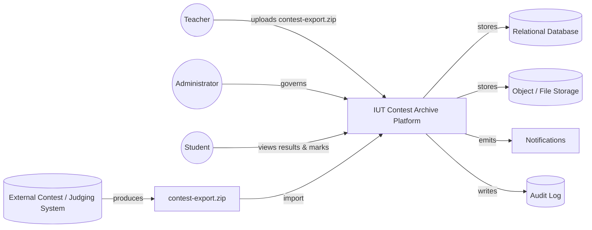
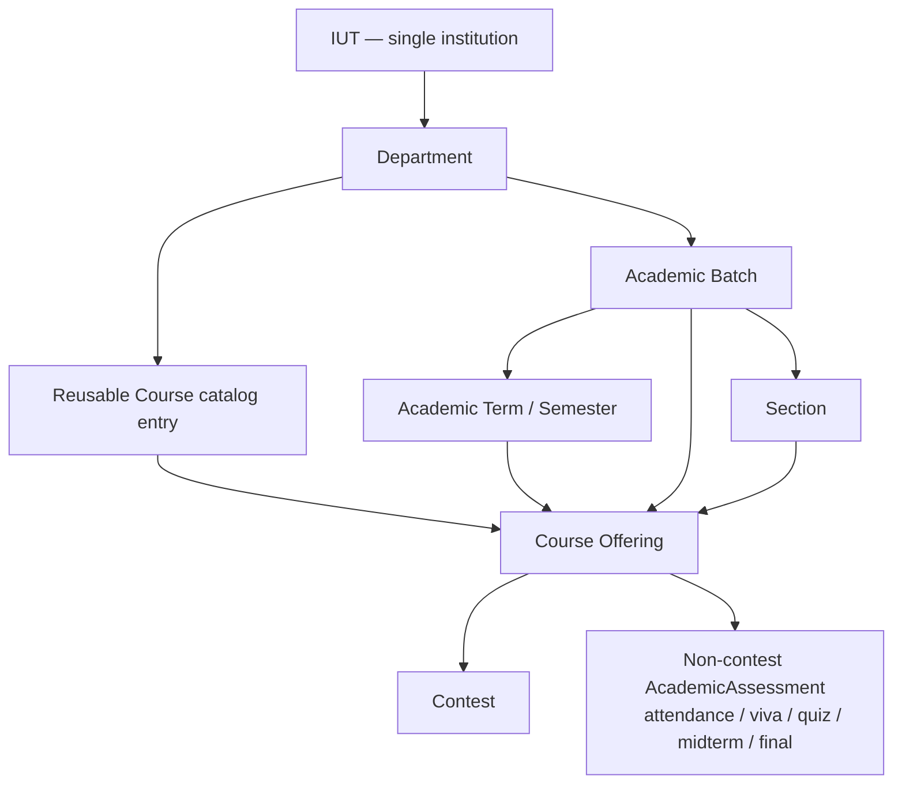
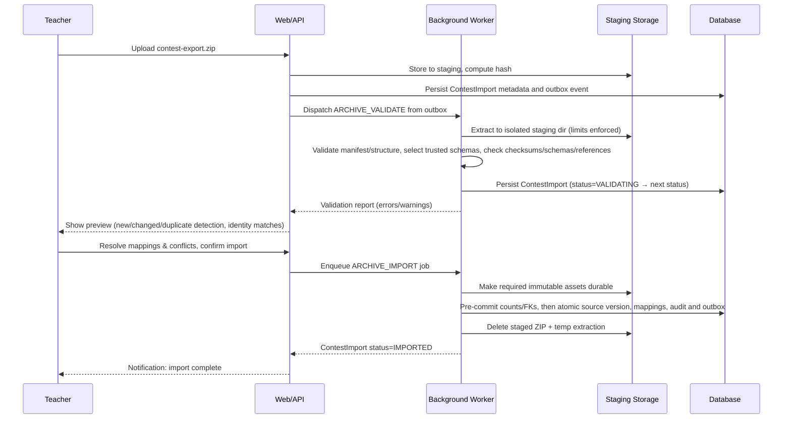
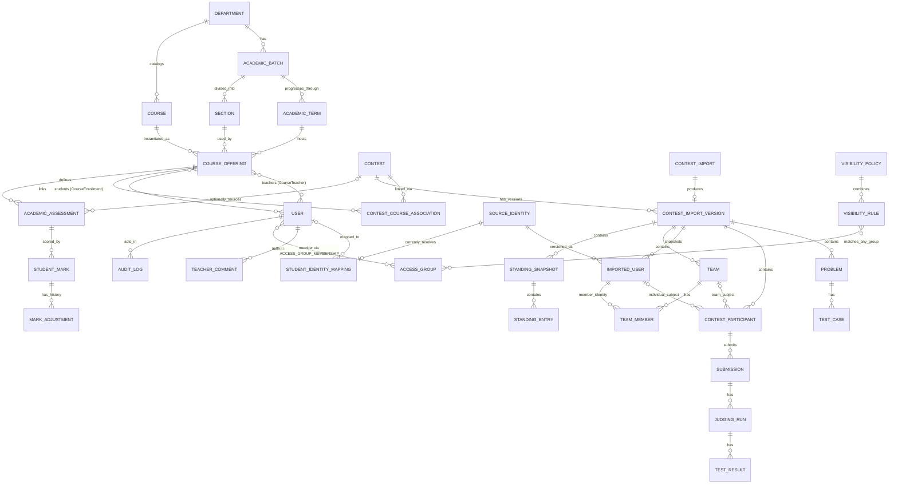
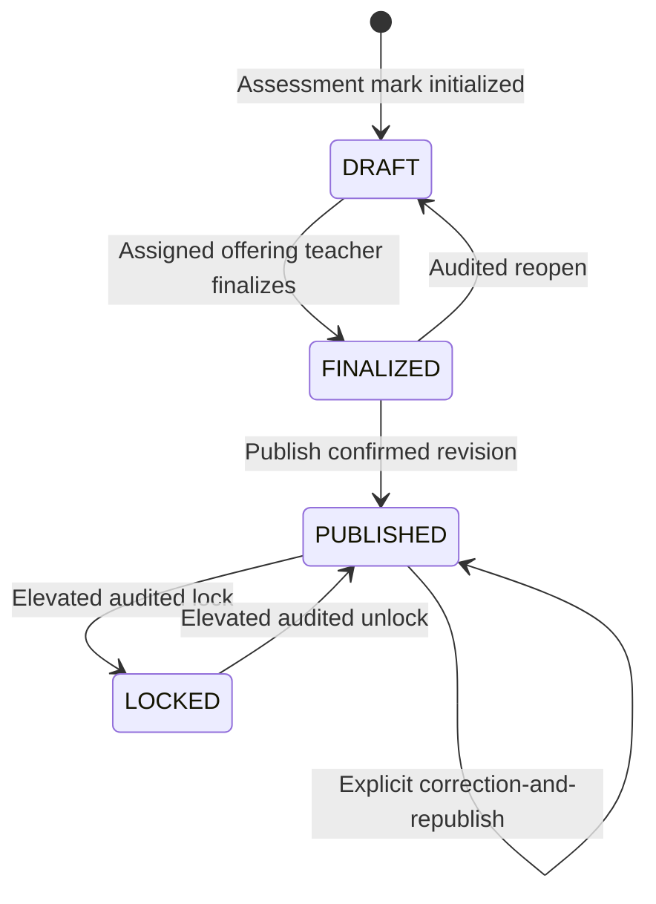
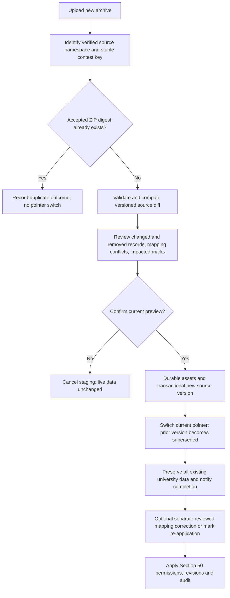
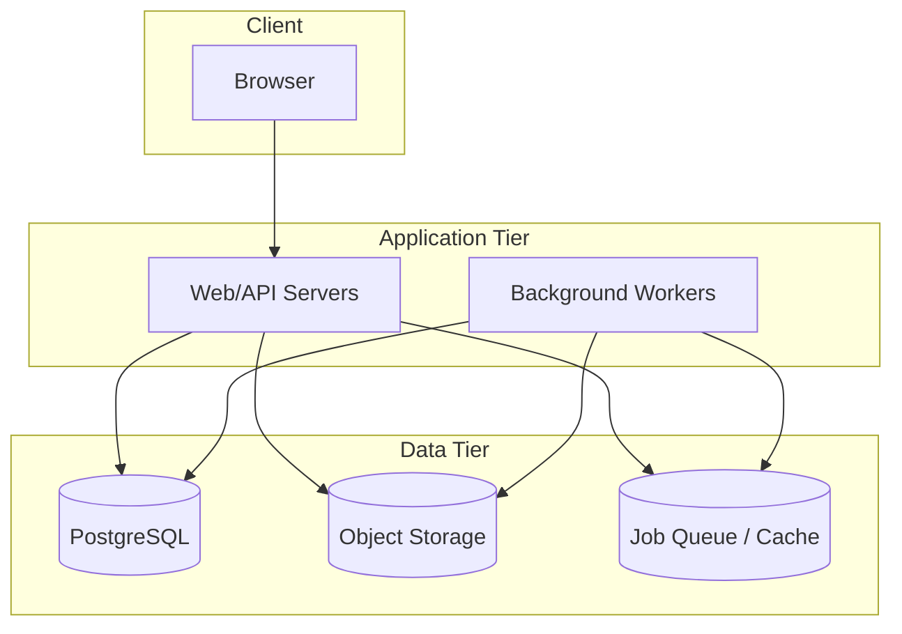

# Software Requirements Specification
## IUT Programming Contest Archive & Academic Platform

**Version:** 1.1 (S001 contract clarification, 2026-10-05)
**Status:** Implementation contracts accepted; exporter schema intake remains gated
**Prepared for:** Islamic University of Technology (IUT)

> **Note on inputs.** This SRS is built from the consolidated master requirements prompt (historical attributions to its Section 48 are unverified because the master prompt is not available in this repository) and the `contest-export.zip` directory/file-level structure supplied separately. The ZIP structure gives file inventory and per-file content semantics, but not the literal JSON Schema property definitions inside `schemas/*.schema.json`. Wherever an exact field name, type, or enum would normally be pinned down, this document specifies the field *categories* inferred from the supplied file comments. Engineering must obtain and pin trusted schemas independently before accepting any archive format version; the archive's own schema copies are never authoritative. This is called out again in Section 11 (Assumptions). The supplied inventory is preserved in [archive-layout.md](archive-layout.md). References explicitly labeled **External master prompt** are historical attributions, not sections of this SRS. Local numbered sections refer to this document. The S001 changes and accepted ADRs are indexed in [sprints/S001.md](sprints/S001.md).

---

## 1. Executive Summary

IUT needs a permanent, authoritative home for programming-contest results that currently live and die on an external judging system. This platform ingests contest exports from that external system, turns them into durable academic records, and layers university-specific concerns — courses, batches, grading, visibility, reporting — on top of data that the platform itself never generates and must never be allowed to silently rewrite.

The system is **not** a judge. It does not run code, does not host live contests, and does not accept submissions. Its job is archival, academic, and analytical: convert contest exports into browsable history, link that history to reusable courses and batch/term/section-specific offerings, let teachers turn contest performance into marks alongside non-contest assessments, and give students, teachers, and admins views appropriate to their role — all while treating every imported byte as untrusted input and every teacher-entered mark as an academic record that must never be lost silently.

A modular monolith, not microservices, is the target architecture at IUT's expected scale (~1,000 regularly active users, historical/inactive accounts retained indefinitely, submission-related records potentially reaching millions of rows over multiple academic years).

---

## 2. Product Vision

A single system that a CSE (or any department's) course can point students to and say: "your Contest 3 grade, your standings, your feedback — all here, permanently, whether or not the judge that ran the contest still exists next year." Teachers get one place to import, grade, and report; admins get one place to govern accounts, structure, and visibility; students get a durable academic record of their programming performance that survives graduation.

---

## 3. Background

Contests currently run on an external judge. Once a contest ends, its data is only as durable as that judge's own retention policy and the export the teacher happens to take. There is no academic linkage (course, batch, marks) built into the judge, no cross-contest analytics, and no institution-controlled visibility model. This platform exists to close that gap without trying to replace or re-implement the judge itself.

---

## 4. Scope

### 4.1 In Scope
- Secure, staged import of `contest-export.zip` archives into retained academic records, subject only to the explicit audited deletion policy in Section 34.
- Academic model: Department → Academic Batch → Academic Term; Department → reusable Course; Batch → Section; Course + Term + Batch + Section → Course Offering, with contests and non-contest assessments attached to Course Offerings.
- Three platform roles (Administrator, Teacher, Student) with server-side RBAC and object-level checks.
- Configurable, component-level visibility (overview, standings, statements, submissions, source code, marks, reports) including academic-context rules and Discord-style Custom Access Groups.
- Gradebook supporting contest-derived marks and generic (non-contest) assessments, with full override/audit history.
- Reporting and analytics at student, problem, contest, course, and batch level.
- Re-import with diff/preview and non-destructive merge of university-generated data.
- Audit logging, notifications, search, and admin governance tooling.

### 4.2 Out of Scope (initial release)
- Live judging, submission execution, or code compilation of any kind.
- Acting as a contest host — no live clarifications, no live standings during an active contest.
- SSO / institutional identity provider integration (deferred to Phase 2).
- Plagiarism/code-similarity detection engine (Phase 2/Future — integration point only).

### 4.3 System Context



The platform has no live connection to the external judge. All contest data enters exactly once per archive, through the upload-and-import pipeline.

---

## 5. Objectives

1. Preserve contest history independently of the originating judge, subject only to the explicit audited deletion policy in Section 34.
2. Never let an import silently damage university-generated data (marks, comments, mappings).
3. Give teachers full control over grading without forcing one grading formula on everyone.
4. Enforce visibility precisely, per contest component, including a lightweight custom-role mechanism.
5. Keep the system boring at IUT's scale: no premature distributed-systems complexity, but a schema and storage layout that doesn't need to be re-architected as historical data grows.

---

## 6. Terminology

| Term | Meaning |
|---|---|
| **Source Contest Data** | Facts imported from `contest-export.zip`, treated as read-only evidence. |
| **University Data** | Facts created inside the platform (marks, comments, mappings, visibility policy). |
| **Course Offering** | One run of a reusable Course for a specific batch, term, and section. |
| **Contest** | A retained record derived from one imported archive (and its re-import history), subject to Section 34's audited deletion policy. |
| **Access Group** | A named, admin/teacher-managed group (e.g. "ICPC Team 2026") used for Discord-style visibility gating, independent of academic structure. |
| **Overlay Record** | A university-authored correction layered on top of an imported record, never overwriting the original. |
| **Placeholder Identity** | A non-login source identity with unresolved platform mapping; no fabricated institutional User or email. |
| **Standing Entry / Snapshot** | A reconstructed or imported ranking row; snapshots preserve standings at a point in time (e.g. freeze). |
| **Grace Period** | The soft-delete window before an irreversible hard-delete is permitted. |

---

## 7. Stakeholders

- **Students** (current and alumni) — consumers of results, marks, feedback.
- **Teachers / Faculty** — import contests, grade, manage courses, run reports.
- **Administrators** — govern accounts, structure, visibility defaults, and platform integrity.
- **IUT CSE Department (initial deploying department)** — primary early adopter.
- **Future departments** — secondary adopters once the academic model is validated.
- **Engineering/maintenance team** — builds and operates the system long-term.

---

## 8. User Classes

| Class | Description | Volume expectation |
|---|---|---|
| Student (active) | Currently enrolled, regularly logs in | Majority of ~1,000 active users |
| Student (alumni/inactive) | Graduated or dormant, retains read access | Grows unbounded over years |
| Teacher | Owns/co-owns courses and contests | Small, stable count |
| Administrator | Global Super Admin only | Very small (single digits) |

---

## 9. Role Definitions

Exactly three platform roles exist: **Administrator**, **Teacher**, **Student**. There is no departmental admin tier and no separate TA role (TAs use the Teacher role). Imported contest roles (e.g. an archive's internal "administrator" role) are a separate concept — **Source Contest Role** — and never imply a Platform Role. See Section 18 (Security) for the explicit non-escalation rule.

- **Administrator:** full governance — accounts, academic structure, courses, contests (including hard-delete), imports, audit, permissions, Access Groups, global settings.
- **Teacher:** manages an Offering through an active CourseTeacher assignment and a Contest through an explicit ContestTeacher assignment. Any co-assigned offering teacher may grade/publish its assessments. Offering assignment alone grants no global contest mutation or re-import right; policy-permitted viewing is available like any other viewer.
- **Student:** views what visibility rules permit: own published/locked marks, permitted individual/team submissions, enrolled courses, and permitted contests/standings.

Administrators may assign more than one of the three fixed roles to a user. Scoped grants combine only after account-state and privacy restrictions; source roles never contribute. The creator of a successfully imported new contest receives an explicit ContestTeacher assignment. Association changes require both contest-management and target-offering authority (or Admin).

---

## 10. Permission Matrix

Legend: **Y** = role grant, still subject to lifecycle/integrity/privacy constraints; **O** = the stated current object scope or viewing policy is required; **—** = no grant from that role. PUBLIC components may be read anonymously when parent gates permit. Teacher does not imply access to all private data.

| Permission | Admin | Teacher | Student |
|---|:---:|:---:|:---:|
| `contest.create` | Y | Y (explicit creator assignment on commit) | — |
| `contest.import` (new) | Y | O (assigned target offering or new unassociated contest) | — |
| `contest.import` (re-import) | Y | O (explicit contest assignment) | — |
| `contest.manage` / soft-delete / visibility / participants | Y | O (explicit contest assignment; changes audited) | — |
| `contest.delete` (hard) | Y (post-grace, audited) | — | — |
| `contest.associate_offering` | Y | O (manage both Contest and target Offering) | — |
| `contest.view` / `standings.view` | Y | O (contest assignment or effective policy) | O (effective policy) |
| `contest.view_private` | Y | O (explicit contest assignment) | — |
| `submission.view` / `view_source` / `download` | Y (governance access audited when hidden/restricted) | O (per-field policy and parent gates) | O (PUBLIC or verified own/team content under TEACHERS_AND_OWNER; parent gates apply) |
| `marks.view` | Y | O (assigned assessment Offering) | O (own PUBLISHED/LOCKED revision only) |
| `marks.assign` / `override` / `finalize` / `publish` / `correct` | Y | O (any current co-assigned offering teacher) | — |
| `marks.lock` / `unlock` | Y (audited) | O (assigned Offering plus admin-delegated lock capability) | — |
| `course.view` | Y | O (assigned) | O (permitted current/historical enrollment) |
| `course.manage` / `course.view_reports` / `students.view_reports` | Y | O (assigned offering scope; no unrelated student history) | — |
| `batch.view_reports` | Y | O (explicit admin-delegated report scope; no implicit individual-mark grant) | — |
| `users.manage` / `roles.manage` | Y | — | — |
| `users.provision_import_student` | Y | O (managed import, validated unmatched participant, separate confirmation) | — |
| `access_groups.manage` | Y | O (explicit delegated group scope) | — |
| `restricted.view` | Y (explicit built-in governance grant; audited) | O (admin-granted capability plus resource scope) | — |
| `audit.view` | Y | O (own-action scope only if delegated) | — |
| `system.manage` | Y | — | — |

**Hard privacy matrix:** These limits apply to UI, REST, background jobs, cached aggregates, notifications, and exports. A second role may confer legitimate scoped staff access; a Student grant alone never does.

| Data | Permitted audience | Cannot be widened by |
|---|---|---|
| Academic marks | Owning student for published/locked values; assigned offering teachers/admin for draft and published values | PUBLIC, Access Groups, contest-only teacher assignment |
| Teacher reports | Assigned offering/report staff within explicit scope; admin | Public contest or arbitrary group membership |
| Private teacher notes | Assigned offering teachers/admin | Feedback/export serializers or student ownership |
| Released feedback | Intended student with a published/locked mark; assigned offering teachers/admin | Other students or public visibility |
| Restricted data | Explicit restricted.view capability and resource scope | Public source code, source role, ordinary course/group membership |
| Source/log/test fields | Independent field policy plus parent contest/component gates | A more permissive sibling field or newly joined team membership |

The effective-policy algorithm is in Section 16.5; the full rationale is [ADR 0004](decisions/0004-permissions-and-provisioning.md).

---

## 11. Assumptions

1. **Academic hierarchy has no Faculty/School layer** — IUT is modeled as a single institution with Departments directly beneath it (External master prompt Section 48 Q1; recommended default per External master prompt Section 49 Item 2). This is the accepted implementation default; a later institutional change needs a documented schema/API migration.
2. **Access Group combination logic:** within a resource, membership in *any one* listed Access Group satisfies that rule (OR); when a resource combines an Access Group rule with a different rule type (e.g. BATCH), all listed rule types must independently pass (AND across rule types) (External master prompt Section 49 Item 3 default).
3. **Contest hard-delete safeguard:** a mandatory soft-delete/recoverable-trash grace period (default 30 days, admin-configurable) precedes irreversible hard-delete; the configured duration must remain positive and no emergency bypass is allowed, reconciling External master prompt Section 48 Item 18 with the "avoid destructive operations" principle (External master prompt Section 49 Item 4 default).
4. **ZIP field-level schema:** exact JSON Schema property definitions for each `schemas/*.schema.json` file were not supplied. Before accepting a format version, engineering must obtain and pin an independently trusted schema set for that version. The importer validates against that trusted set and rejects archive-supplied schemas that differ; this document defines expected field *categories* from the supplied inline descriptions (see Section 14). Size/count/nesting limits are conservative, admin-configurable defaults (Section 23), not values derived from an actual schema.
5. Institutional email + password is the only MVP authentication method; no SSO at launch.
6. "Team contests" require first-class `Team`/`TeamMember` entities distinct from individual participation.
7. The original ZIP is never retained post-import; it exists only transiently in the staging area during validation/import (and briefly after a failure, for debugging).
8. Restricted archive contents (`restricted/`) are imported, when present, into separately access-controlled storage — never treated as public just because they parsed successfully.

---

## 12. Constraints

- No microservices without a demonstrated need; start as a modular monolith.
- No live judging functionality of any kind, even experimentally.
- Must not execute any code, script, checker, validator, or generator found inside an archive.
- Must preserve the distinction between "unavailable," "excluded," "empty," "truncated," and "corrupted" data — never fabricate values the source system didn't record.
- Re-import must never silently overwrite teacher-authored academic data.
- All authorization decisions must be enforced server-side; UI hiding is not a control.

---

## 13. University Academic Model



- **Department:** top-level academic unit directly under IUT (Assumption #1).
- **Academic Batch:** an admission cohort (e.g. "CSE 2025").
- **Academic Term:** a semester within a batch's academic career; its batch must match the offering's batch.
- **Course:** a catalog entity (code, title, credit hours, description) — reusable across terms.
- **Course Offering:** one concrete run of a reusable Course for a given batch/term/section, with its own teacher assignments (many-to-many) and enrollment list. The Course and Batch must belong to the same Department. This is the anchor for both contests and non-contest assessments (External master prompt Section 48 Q10).
- **Section:** a subdivision of a Batch (e.g. Section A/B) reused across terms; an Offering references exactly one Section from its Batch. Use an explicit `ALL` Section for an unsplit batch.
- **Contest:** may belong to zero, one, or multiple Course Offerings. Each Offering owns its own assessments, and a Contest may feed multiple independent assessments. Tags (Lab, Quiz, ICPC Training, etc.) never replace an Offering link.
- **Teachers and enrollment:** retain effective-dated assignment history. All current co-assigned offering teachers have the documented grading rights; removal revokes current rights while preserving authorship and student academic history.

---

## 14. Contest Archive Model

The archive's top-level layout maps to platform concepts as follows (derived from the supplied `contest-export.zip` tree):

| Archive area | Platform mapping | Notes |
|---|---|---|
| `manifest.json` | `ContestImport` metadata (format version, source, snapshot time, counts, exclusions) | Read first; drives the entire validation plan. |
| `checksums.sha256` | Per-file integrity check | Every regular archive file except the checksum file must be listed exactly once and match. |
| `schemas/*.schema.json` | Archive-supplied schema copies | Compare against the trusted schema set selected by manifest format version; archive copies never define the validator's authority (Assumption #4). |
| `contest/*` (contest.json, settings.json, schedule.json, scoring-rules.json, access-policy.json, organizers.json, rules.html, description.html) | `Contest` core record + `ContestSettings`/`ScoringRule` | HTML fields sanitized before storage/render (Section 18). |
| `people/*` (users, participants, teams, team-memberships, registrations, access-grants, contest-role-assignments) | `SourceIdentity`, `ImportedUser`, `ContestParticipant`, `Team`, `TeamMember`, `StudentIdentityMapping` inputs | Drives IMPORT-006 in Section 16.3 and UC-02 in Section 36. Source contest roles land in a separate table from platform roles (Section 18/Security). |
| `problems/*` | `Problem`, `TestCase`, `TestGroup`, plus checker/validator/generator/reference-solution/editorial/attachment metadata | Source files (checkers etc.) are stored as opaque blobs; never executed (Sections 12 and 18). |
| `judging/*` (environment, languages, judge-configurations, execution-profiles, dependency-inventory) | `JudgeEnvironmentSnapshot` — informational/historical only | Not used to re-run anything. |
| `submissions/*.jsonl` (submissions, judging-runs, test-results, score-adjustments, rejudge-history, deletion-history) | `Submission`, `JudgingRun`, `TestResult`, source-side score adjustment/rejudge/deletion history | Streamed line-by-line during import (Section 26 — never loaded fully into memory). |
| `results/*` | `StandingEntry`, `StandingSnapshot` (final + frozen + timestamped snapshots), `ParticipantResult`, `ProblemStatistic`, `ContestStatistic`, `Award`, `Certificate` | Final/frozen standings are marked `IMPORTED OFFICIAL`; any platform-side recompute is a separate, clearly labeled `RECALCULATED VIEW` (Section 16.7). |
| `communication/*` | `Announcement`, `Clarification` (+history), `Notification` (historical, informational) | Read-only historical record; not a live clarification system. |
| `materials/*`, `files/*` | `FileAsset` rows + object storage | Paths are archive-relative; platform never exposes raw filesystem paths (Section 31). |
| `history/*.jsonl` | `ContestEvent`, `ConfigurationChange`, `ProblemRevision`, `AdministrativeAction`, `AuditEvent` (source-side) | Imported as historical facts, kept distinct from the platform's own `AuditLog`. |
| `presentation/*` | `Branding`/`Navigation`/`PageContent`/`Localization` snapshot | Informational; platform branding is configured separately (Section 53), not driven by imported branding. |
| `restricted/*` | `RestrictedFileAsset` + restricted-only tables, access-controlled separately from everything else | Folder name is not a security boundary — enforced via explicit permission (`restricted.view`), off by default for ordinary users; admin governance grant and delegated teacher scope are defined in Section 10. |
| `reports/*` (CSV/PDF) | Not imported as data; ignored for structured purposes | Convenience-only; never authoritative over the JSON/JSONL records. |

Source-code and binary blobs under `files/submissions/.../source.*`, `runs/.../compiler-output.txt`, `judge-log.txt`, `tests/*/stdout.txt` etc. are stored as `FileAsset` records keyed by the archive-relative path, with independently configurable visibility per Section 16.5.

---

## 15. Import Architecture

### 15.1 Pipeline

```
UPLOAD → SECURITY CHECK → EXTRACT (staging) → VALIDATE MANIFEST
→ VALIDATE STRUCTURE → SELECT TRUSTED SCHEMAS → VALIDATE CHECKSUMS → VALIDATE SCHEMAS → VALIDATE REFERENCES
→ ANALYZE USERS → DETECT EXISTING CONTEST → DETECT DUPLICATES → PREVIEW
→ RESOLVE MAPPINGS/CONFLICTS → TEACHER CONFIRMATION → TRANSACTIONAL IMPORT
→ POST-IMPORT VALIDATION → COMPLETE
```

### 15.2 Import States

Job states: `UPLOADED → VALIDATING → VALIDATION_FAILED | MAPPING_REQUIRED | CONFLICT_REVIEW_REQUIRED | READY_TO_IMPORT`; resolution may move MAPPING_REQUIRED to CONFLICT_REVIEW_REQUIRED, and both required reviews must complete before READY_TO_IMPORT. Explicit confirmation yields `IMPORTING → IMPORTED | IMPORT_FAILED`.

Pre-commit cancellation yields `CANCELLED` after safe worker stop/cleanup. Retry is allowed only after recovery verifies unchanged bytes, fresh validation/preview as needed, and current authority; changed bytes require a new upload. A committed import cannot be canceled back into a pre-commit state.

Version state is separate: a newly committed version is `CURRENT`; the previous one becomes `SUPERSEDED`. Its producing job remains `IMPORTED`. Exact duplicate jobs may finish `IMPORTED` with `outcome=EXACT_DUPLICATE` and an existing-version reference, without producing another version or switching the current pointer. Contest lifecycle uses `ACTIVE`, `ARCHIVED`, `SOFT_DELETED`, and retained academic `TOMBSTONE` separately. See [ADR 0003](decisions/0003-source-versions-and-import-states.md) for recovery rules.

### 15.3 Import Sequence Diagram



### 15.4 Storage record: `ContestImport`

Per import: uploader, upload timestamp, source filename, ZIP hash, source application, source namespace/installation, source application version, stable contest key, export identifier when supplied, archive format version, archive timestamp, validation status, warning count, error count, imported record counts (per entity type), import version number, import logs (structured, queryable), final status, and links to the resulting `Contest`/`ContestImportVersion`.

### 15.5 Non-destructive re-import (see also Section 51)

Every accepted non-duplicate re-import produces a new `ContestImportVersion` after a staged diff is reviewed. Prior source rows remain immutable. Source-version promotion never writes university marks, comments, existing mappings, publication state, or visibility policies; their correction/re-application is a separate explicit action. Staging, job, and audit writes are permitted before confirmation. Separately confirmed account provisioning follows AUTH-002 and IMPORT-006.

---

## 16. Functional Requirements

Requirement IDs follow the scheme in External master prompt Section 46: `AUTH-###`, `IMPORT-###`, `IMPORT-SEC-###`, `CONTEST-###`, `COURSE-###`, `STANDING-###`, `SUBMISSION-###`, `VISIBILITY-###`, `MARK-###`, `REPORT-###`, `AUDIT-###`, `ADMIN-###`. The set below is representative and load-bearing, not exhaustive — an implementer should extend the same pattern for remaining flows named elsewhere in this document.

### 16.1 Authentication & Accounts

**AUTH-001 — Institutional login**
- Actors: all roles.
- Description: The system MUST authenticate users via institutional email + password (MVP). SSO is out of scope for MVP (Section 53).
- Preconditions: account exists, verification/required approval are complete, and lifecycle permits login. `PENDING`, `SUSPENDED`, `ARCHIVED`, and `ANONYMIZED` cannot authenticate; sessions recheck current state.
- Normal flow: submit credentials → verify hash → issue session.
- Failure: invalid credentials → generic error (no user-enumeration); repeated failures → rate-limited/lockout (Section 18).
- Acceptance: valid credentials succeed; invalid credentials fail with a generic message; lockout triggers after a configurable threshold.

**AUTH-002 — Account creation**
- Administrators MUST be able to create accounts individually or via bulk import (CSV/XLSX mapping to `User`/`UserProfile` and enrollment) in MVP; Phase 2 adds automated synchronization and richer identity matching.
- Self-registration with an institutional email MUST be supported, subject to domain allow-listing, verified email ownership, and optional admin approval.
- `users.provision_import_student` is a narrow separate accounts-service command for a managed import. Explicit confirmation creates only a PENDING Student with unusable password and invitation/verification requirements. It cannot copy source credentials, select elevated roles, mutate an existing account, or grant `users.manage`. Requests are idempotent and audited; cancellation of the contest import does not erase the independently provisioned account.

**AUTH-003 — Account lifecycle**
- States: `PENDING`, `ACTIVE`, `INACTIVE`, `GRADUATED`, `ALUMNI`, `SUSPENDED`, `ARCHIVED`, `ANONYMIZED`. PENDING becomes ACTIVE only after verification and required approval. Recorded inactivity may change ACTIVE to INACTIVE; successful login reactivates it. Graduation/alumni transitions are audited. ANONYMIZED is terminal; “deleted account” describes this outcome, not another enum.
- Alumni/graduated accounts MUST retain login and full historical read access indefinitely (External master prompt Section 48 Q14).
- Suspension, archive, anonymization, and restoration of a recorded prior eligible state MUST be admin-only and audited. Suspension/archive invalidate existing sessions; anonymization cannot be reversed by a login/reset token. Alumni access remains subject to resource privacy and lifecycle gates.

### 16.2 University Structure Management

**ADMIN-010 — Manage academic hierarchy**
- Admins MUST be able to create/edit/archive Department, Academic Batch, Academic Term, Course, Course Offering, Section.
- Both Admins and Teachers MAY create Course Offerings (External master prompt Section 48 #25); Teachers MUST be attached as an offering teacher to gain `course.manage` on it.

**COURSE-001 — Course Offering teacher assignment**
- Many-to-many assignment of teachers to a Course Offering and to a Contest MUST be supported (External master prompt Section 48 #23).

### 16.3 Contest Import

**IMPORT-001 — Upload archive**
- Actor: for a new contest, Teacher assigned to the target Offering or creating an unassociated contest, or Admin. Re-import requires explicit ContestTeacher assignment or Admin. Successful first import gives the creator an explicit contest assignment; linking offerings never silently grants it to other staff.
- Precondition: file is a `.zip`, within the configured max upload size (Section 23).
- Flow: upload → staged, never trusted → pipeline per Section 15.
- Failure: oversized/wrong-type upload rejected before extraction begins.

**IMPORT-002 — Validate manifest & structure**
- The system MUST parse the bounded `manifest.json` first and use its declared format version to select an independently trusted, pinned schema set. An archive-supplied schema may be compared with this set but MUST NOT replace it.
- Unknown/unsupported format version → `VALIDATION_FAILED` with a clear message; MUST NOT attempt best-effort parsing of an unrecognized version.

**IMPORT-003 — Schema & checksum validation**
- Every JSON/JSONL file MUST validate against its corresponding trusted schema. A format version cannot be supported until its complete schema set is pinned and reviewed.
- `checksums.sha256` MUST list every regular archive file except itself exactly once; missing, extra, duplicate, or mismatched entries are hard validation failures. These self-contained checksums detect corruption but do not authenticate the archive's origin; any origin-authentication requirement needs an independent signature or trusted transport.

**IMPORT-004 — Reference integrity**
- Cross-record references (e.g. a submission's problem/participant IDs) MUST resolve within the archive; dangling references are reported per-record, not fatal to the whole import unless the reference is structurally required (e.g. a submission with no resolvable participant).

**IMPORT-005 — Duplicate/existing-contest detection**
- Identify Contest by a verified `(source_namespace, stable_contest_key)`; product name, export ID, and import-job ID are not interchangeable with that key. S025 must establish the exporter mapping; if unavailable, do not guess it. Namespace registration is admin/adapter-controlled, not trusted solely from upload content.
- Classify new/re-import/exact duplicate using the stable contest key and accepted payload digest. Constrain `(contest_id, zip_sha256)` on committed versions; repeated job rows may reference an existing version. A duplicate of an older version does not roll back the current pointer. A repackaged ZIP with the same logical content may be a no-change re-import, not a false byte-duplicate claim.

**IMPORT-006 — Identity mapping**
- Per UC-02 in Section 36: attempt deterministic auto-matching (e.g. IUT student ID present in `people/users.json`); present ambiguous matches for manual resolution; for archive users with no match, expose all four strategies (placeholder identity, remain unmapped, create full account, map to existing account) with an optional bulk default and per-row override (External master prompt Section 48 #21).
- MUST NOT auto-assign an ambiguous match. Source identities are scoped to namespace; placeholders are non-login identities. Team participants reference Team, not an arbitrary member. Confirmed identity mappings are published only with the import or a later separately authorized mapping correction.
- Full-account resolution calls the separately confirmed AUTH-002 provisioning command. Its pending account/audit may persist before import confirmation, but no live contest/source/confirmed-mapping rows may be written. Existing-account conflicts return to manual mapping review.

**IMPORT-007 — Teacher confirmation gate**
- No live Contest, Submission, StandingEntry, or confirmed identity mapping is written until explicit import confirmation. Job/staging/audit records and separately confirmed AUTH-002 pending-account provisioning are allowed earlier. Bind confirmation to ZIP digest, schema registry revision, current version, mapping-plan revision, and current authority; stale preview returns a conflict without publication. The preview includes validation warnings, mapping decisions, and the Section 51 diff.

**IMPORT-008 — Transactional commit**
- Import MUST be logically atomic: validate counts and references before the database commit; ensure required object-storage assets are durable before making the database records visible; commit all database rows in one transaction. Failed imports MUST leave prior production state untouched. Staged/orphaned blobs must be tracked and cleaned up after failure or retry, since object storage does not join the database transaction.

**IMPORT-009 — Pre-commit integrity and post-commit availability checks**
- Before commit, the system MUST verify imported record counts against `manifest.json`'s declared counts (excluding intentionally excluded sections). An unexplained discrepancy blocks the commit. Post-commit checks may verify availability and report an operational failure, but MUST NOT silently convert a data-integrity error into a warning.

**IMPORT-SEC-001 — Archive security checks**
- MUST defend against: ZIP Slip/path traversal, absolute paths, symlink attacks, zip bombs/extreme compression ratios, excessive file count, deep nesting, oversized extraction, malformed JSON/JSONL, malicious HTML (sanitized on render, never trusted raw), MIME spoofing, unsafe file types, duplicate paths.
- MUST NOT execute any script/checker/validator/generator/reference-solution/submission source found in the archive, under any circumstance.

### 16.4 Contest & Course Pages

**CONTEST-001 — Contest record**
- A Contest exposes: title, description, source, dates, scheduled/actual duration, freeze state, associated Course Offering(s), tags, organizers, problem list, standings, participant count, statistics, announcements, materials — each independently visibility-gated (External master prompt Section 17/18; VISIBILITY-### below).

**CONTEST-002 — Contest-course association**
- A contest MAY belong to zero, one, or multiple Course Offerings, and independently carries free-text tags. Tags MUST NOT be used as a substitute for a Course Offering link when academic marks are involved.

### 16.5 Visibility

**VISIBILITY-001 — Component-level visibility**
- Each of: overview, standings, problem statements, submissions, source code, editorials, teacher reports, marks, restricted materials MUST have an independent visibility policy. Public-facing contest components may use `PUBLIC, IUT_ONLY, DEPARTMENT, BATCH, COURSE, TEACHERS_ONLY, PRIVATE, ARCHIVED, CUSTOM_GROUP` as applicable. Hard ceilings apply regardless of configuration: academic marks are visible only to the owning student and authorized assigned teachers/admins; teacher reports are visible only to authorized teachers/admins; restricted materials require `restricted.view`. Access Group membership never overrides these ceilings.
- Inheritance: `System Default → Course Default → Contest Setting → Specific Override`. Resolve lifecycle/account restrictions and hard privacy limits first, then parent gates and the effective component rules. More-specific explicit rules replace inherited rules for that component, never hard ceilings or hidden parents. With multiple linked offerings and no explicit contest/component rule, intersect all applicable offering defaults. Missing defaults resolve to PRIVATE; a deleted group remains unsatisfied. “ARCHIVED” visibility denies normal viewing; admin governance remains audited.
- Model a policy as a rule set with typed rule rows and membership joins, so AND across rule types is representable. TEACHERS_ONLY means assigned relevant staff, not all teachers. Offering teachers manage their assessments; contest-wide policy changes require explicit contest assignment.

**VISIBILITY-002 — Access Groups**
- Admins and explicitly delegated Teachers may create/manage Access Groups in their granted scope, assign/remove members (audited), and gate eligible components. Group membership cannot widen academic/restricted privacy ceilings.
- Combination rule: OR within the Access Group list on one rule; AND across distinct rule types on the same resource (Assumption #2).

**VISIBILITY-003 — Submission/source visibility**
- Independently configurable: submission metadata, verdict, source code, compiler output, judge log, per-test-result — each from `PUBLIC, TEACHERS_ONLY, TEACHERS_AND_OWNER, HIDDEN` (External master prompt Section 48 Q7). `PUBLIC` permits any viewer only when the parent contest and submission component are also visible; `HIDDEN` denies all normal viewers except an authorized administrator performing governance or recovery duties.
- Public source-code visibility MUST NOT imply exposure of hidden test data. For TEACHERS_AND_OWNER, an individual owner needs a verified source identity mapping; team ownership requires mapped membership evidenced at the source submission time. Unknown membership times do not grant access, and joining a team later grants no retroactive private-source access.

### 16.6 Grading

**MARK-001 — Auto-assign from archive**
- If the archive supplies a mark/score suitable for direct academic use, the system auto-assigns it as the initial academic mark; otherwise the field is left blank for manual entry (External master prompt Section 48 #6). The mark records the source import version used, so later source changes cannot silently change a published academic mark.

**MARK-002 — Configurable grading methods**
- The grading engine MUST support, per Course Offering or per assessment: proportional conversion, fixed thresholds, percentage, weighted-contest aggregation, manual entry, best-N-of-M, drop-lowest-N, bonus rules, and a safely sandboxed custom formula (no arbitrary code execution against production data).

**MARK-003 — Non-contest assessments**
- `AcademicAssessment` belongs to exactly one Offering and references zero or one Contest; one Contest may feed multiple independent Assessments. It is a generic concept; a contest-derived mark is one instance. Attendance, viva, assignments, offline quizzes, midterms, finals MUST be representable the same way, all rolling into the same gradebook (External master prompt Section 48 #10).

**MARK-004 — Overrides preserve history**
- Every manual adjustment MUST retain: original calculated value, previous value, new value, delta, reason, actor, timestamp. No adjustment may overwrite/delete a prior value in place.

**MARK-005 — Publication workflow**
- States and commands follow Section 50. Any current co-assigned offering teacher may finalize/publish/correct; no single-founder or coordinator sign-off is required. Students see only PUBLISHED/LOCKED revisions, and never DRAFT/FINALIZED values through pages, totals, or exports. A published correction is a separate audited atomic correction-and-republish; LOCKED changes require authorized unlock first.

**MARK-006 — Re-import preservation**
- A re-import that updates a contest's source score MUST NOT overwrite an existing academic mark, teacher comment, course mapping, or publication status unless a teacher explicitly re-applies the auto-assignment (Sections 15.5, 50, and 51).

### 16.7 Standings & Submissions

**STANDING-001 — Reconstruction**
- Standings MUST be reconstructable from imported data (rank, participant, ID, solved count, score, penalty, per-problem detail, attempts, solve time, first-to-solve, official/unofficial, disqualification).
- `IMPORTED OFFICIAL STANDINGS` and any platform-side `RECALCULATED VIEW` MUST be clearly and separately labeled; recalculation MUST NOT silently replace the imported official record.

**SUBMISSION-001 — Inspection**
- Submission inspection (metadata, verdict, source, compiler output, judge log, per-test result) is gated per VISIBILITY-003, independently per field.

### 16.8 Reporting/Analytics — see Sections 21–22.

---

## 17. Non-Functional Requirements

| Category | Requirement |
|---|---|
| Scalability | Support ~1,000 regularly active users; unbounded historical/inactive accounts; submission-related tables reaching tens of millions of rows over years without redesign. |
| Modularity | Modular monolith with clear module boundaries (Section 56 and ADR 0001) so any module could later be extracted if a genuine need arises. |
| Data integrity | No silent data loss on import failure, re-import, or concurrent edits. |
| Observability | Structured import logs, audit trail, and background-job status must be queryable by admins. |
| Maintainability | Avoid bespoke infrastructure; prefer well-supported, boring technology (Section 56 and Appendix A). |
| Portability | File storage abstracted behind an interface (local disk for dev, object storage for production) so the choice isn't hardwired into business logic. |

---

## 18. Security Requirements

- **AUTHZ:** Server-side RBAC with object-level checks on every protected endpoint; UI-only hiding is never sufficient. No permission may be inferred purely from an imported contest role (External master prompt Section 14) — Source Contest Role and Platform Role are stored and checked independently, and importer code may never write platform role/credential fields. A separately confirmed accounts-service provisioning command may create only a fixed Student role as specified in AUTH-002; this is not privilege inheritance from the archive.
- **Injection/XSS:** Parameterized queries/safe ORM only; all imported HTML (`rules.html`, `description.html`, editorial content, announcements) sanitized through an allow-list sanitizer before storage-adjacent rendering; output-encode everywhere else.
- **CSRF:** Standard anti-CSRF tokens on state-changing requests from browser sessions.
- **File upload safety:** MIME/type validation independent of client-supplied extension; archive contents never executed; extracted files served only through authenticated application endpoints or short-lived signed URLs, never raw filesystem paths.
- **Session/password security:** Secure, `HttpOnly`, `SameSite` cookies; salted strong password hashing (e.g. bcrypt/argon2 class); configurable session expiry.
- **Brute force/rate limiting:** Login and password-reset endpoints rate-limited and lockout-capable; import endpoints rate-limited per user.
- **IDOR:** Every resource fetch by ID re-checks ownership/visibility server-side, regardless of how the ID was obtained (see Section 55 Testing).
- **Mass assignment:** Explicit field allow-lists on every write endpoint, especially mark and visibility endpoints.
- **Audit integrity:** Audit log entries are append-only from the application's perspective (no update/delete endpoint exists for audit rows).
- **Sensitive data leakage:** Restricted archive sections (`restricted/*`) require an explicit `restricted.view` permission, off by default even for teachers; search results and error messages never leak the existence of resources the requester can't see (Sections 18 and 29).

---

## 19. Privacy Requirements

- Academic marks are visible only to the owning student after publication and authorized assigned teachers/admins. Course/contest configuration may narrow access or delay publication but MUST NOT widen it to other students, Access Groups, or the public (Section 16.5).
- Private teacher-only notes and student-visible feedback are stored as distinct fields with distinct visibility — a private note MUST NOT leak into a student-facing view by default (External master prompt Section 48 #15).
- Restricted archive data (credentials hashes, workstation/IP records, integrity reports, administrative notes) is stored separately from general contest data and is never exposed through public or student-facing endpoints.
- Personal data retention follows the account lifecycle (Section 16.1); an `ANONYMIZED` terminal state exists for policy-driven erasure while preserving referential integrity of historical academic records (e.g. anonymized display name retained on old standings).

---

## 20. Audit Requirements

Every important action is recorded with: actor, action, target entity, timestamp, previous value, new value (where applicable), reason (where applicable), and session/device/IP metadata where legally appropriate.

Audited action categories: login security events (failed logins, lockouts, password resets); contest upload/import/re-import; contest archive/delete (soft and hard); visibility changes; Access Group creation/membership changes; student identity mapping changes; mark changes (assign/override/publish/lock/unlock); role/permission changes; enrollment changes; administrative actions generally.

---

## 21. Reporting Requirements

- **Student report:** contests participated/missed, problems attempted/solved, submission counts by verdict, average attempts-to-solve, contest scores, academic marks, performance over time, per-problem-category performance, language usage where available. No metric is fabricated beyond what the archive/gradebook actually recorded. Marks within a report obey the hard privacy ceiling in Section 16.5.
- **Problem report:** attempts, solvers, solve rate, average/median attempts, average/median solve time, verdict distribution, language distribution, score distribution, first-to-solve info. Any derived "difficulty" metric MUST ship with an explicit, documented formula.
- **Contest report:** participant/submission counts, solve rates, score/penalty/verdict distributions, per-problem performance, language usage, academic mark distribution, participation rate — with both a Summary and a Detailed view.
- **Course report:** enrollment, contest count, participation rate, missing-contest list, average score, mark distribution, contest comparison, problem performance, progression over time, gradebook overview; drill-down Course → Student → Contest → Problem → Submission where permissions allow.
- **Batch-level reports:** cross-course performance, course comparison, participation, semester trends — admin-only by default. An explicit delegated teacher report grant names the allowed offerings in a batch and grants only that projection; it neither includes other offerings nor grants individual mark access.
- **Export formats:** CSV, XLSX, and PDF all required (External master prompt Section 48 #8) for gradebook/report exports.

---

## 22. Analytics Requirements

Analytics are computed from committed platform data (post-import), not recomputed from raw archive files on every request. Heavy aggregates (contest statistics, problem statistics, course-level trends) are precomputed by background jobs (Section 26) and cached/materialized where read volume warrants it, refreshed on import/re-import/mark-publication events.

---

## 23. Import Validation Requirements

Configurable (admin-tunable, safe conservative defaults) limits, since no field-level ZIP spec was available to size these precisely (Assumption #4):

| Limit | Suggested default | Rationale |
|---|---|---|
| Max ZIP upload size | 2 GB | Large archives (source, tests, judge logs) expected; tune per observed IUT contest sizes. |
| Max extracted size | 8 GB | Guards against compression-ratio bombs; ratio-checked incrementally during extraction, not just at the end. |
| Max file count | 200,000 | Large contests with many test cases/submissions/runs. |
| Max individual file size | 512 MB | Covers large PDFs/statement bundles; submission source files are expected to be tiny by comparison — outliers flagged for review. |
| Max path nesting depth | 12 | Comfortably covers the deepest documented path (`files/submissions/submission-{id}/runs/run-{id}/tests/test-{id}/...`). |
| Max compression ratio per file | 100:1 | Flags likely zip-bomb components for manual review before full extraction. |

All limits above are stored as system settings, editable by an Administrator, and re-evaluated per import (not hardcoded into the pipeline). Validation MUST proceed in the order specified in Section 15.1 so that cheap/security-relevant checks (structure, size, path safety) run before expensive checks (checksum, schema, reference validation).

---

## 24. Error Handling

- Every pipeline stage produces structured, stage-tagged errors/warnings (not a single opaque failure message), stored on the `ContestImport` record and surfaced in the preview UI.
- Distinguish, and never conflate: **unavailable** (not present in this archive format/version), **excluded** (deliberately omitted per manifest), **empty** (present but zero records), **truncated** (partial data, flagged by the source), **corrupted** (failed integrity check) — each rendered differently in the UI rather than collapsed to "no data."
- User-facing errors never leak internal paths, stack traces, or raw exception text; detailed diagnostics go to the import log, visible only to authorized teachers/admins on that import.

---

## 25. Backup and Recovery

- **Database:** regular full backups + point-in-time recovery, retention per institutional policy (recommend ≥ 90 days rolling, admin-configurable).
- **Original ZIP:** not retained post-success (External master prompt Section 48 #19); kept only transiently in staging during validation/import, and briefly (configurable, e.g. 7 days) after a failed import for debugging, then purged.
- **Extracted/derived files:** backed up as part of object storage backup policy; generated reports (CSV/XLSX/PDF) are regenerable on demand and need lighter backup guarantees than source data.
- **Soft-deleted contests:** included in backups throughout their grace period (Section 11 #3) so recovery is possible even from a backup taken during the grace window.
- **Disaster recovery:** documented restore runbook; recovery point/time objectives set per institutional risk tolerance — recommend RPO ≤ 24h, RTO ≤ 8h as a starting target for a system of this criticality/scale.

---

## 26. Performance Requirements

- Paginate every list endpoint (contests, submissions, standings, users, audit log) by default.
- Index all foreign keys and all commonly filtered/sorted columns (Section 45).
- Stream JSONL parsing during import (submissions, judging-runs, test-results, etc.) — never load an entire archive into application memory.
- Batch database writes during import (bulk insert, not per-row round-trips).
- Background jobs for anything that scales with archive size (validation, import, analytics recompute, large exports, report generation) — synchronous HTTP requests must not block on these.
- Aggregate queries for reports use precomputed/cached statistics where the underlying data is large and stable (post-import), recomputed on the triggering event rather than on every page view.
- Do not optimize for concurrent load beyond IUT's realistic scale; correctness and index coverage matter more than premature caching layers here.

---

## 27. Accessibility

Semantic HTML, full keyboard navigation, labeled form controls, sufficient color contrast, responsive layouts down to mobile width. Administrative/analytics-heavy screens (gradebook, reports) may prioritize desktop layout but must remain usable (not broken) on tablet/mobile.

---

## 28. UI/UX Requirements

Key workflows that must be designed as guided, multi-step flows rather than single forms: ZIP upload → validation → preview; participant identity mapping (bulk default + per-row override); re-import diff/conflict resolution; grade assignment and publication; student performance drill-down; course analytics; visibility configuration (including Access Group assignment). Data-dense teacher tables (gradebook, submissions, standings) support search, filter, sort, pagination, and responsive overflow; configurable columns where useful.

---

## 29. Search Requirements

Global and contextual search across contests, students, teachers, courses, problems, filterable by department, batch, semester, section, course, teacher, contest type, tag, date range, academic year, and Access Group. Every result is filtered server-side by the requester's visibility — a private resource must never be discoverable via search by someone who couldn't otherwise view it (no "you found it but can't open it" leakage).

---

## 30. Notification Requirements

In-app notifications, at minimum, for: import success, import failure, participant-mapping-required, contest made available, marks published, teacher feedback added, enrollment changes, admin warnings (e.g. failed import spike, storage threshold). Email is optional/configurable per notification type, not assumed for every event.

---

## 31. File Storage Requirements

| Category | Retention | Access |
|---|---|---|
| Database data | Primary source of truth for structured facts | Per RBAC |
| Original ZIP | Transient only (Section 25) | Import pipeline only |
| Extracted files (statements, source, tests, attachments, materials, certificates, etc.) | Permanent, tied to the `Contest` lifecycle | Per component-level visibility (Section 18) |
| Restricted files (`restricted/*`, evidence) | Permanent, separately controlled | `restricted.view` only |
| Generated reports (CSV/XLSX/PDF) | Cached/regenerable | Same visibility as the underlying data |

Raw filesystem/object-storage paths are never returned to clients; all file access goes through authenticated endpoints or short-lived signed URLs.

---

## 32. API Requirements

REST is recommended as the default (Section 32 and ADR 0001) given the resource-oriented nature of the domain (contests, courses, submissions, marks map cleanly to REST resources) and the team-familiarity/tooling benefits at this scale. A small number of workflow-shaped endpoints (import preview, mapping resolution, mark publication) are modeled as explicit action sub-resources (e.g. `POST /api/imports/{id}/confirm`) rather than forcing every operation into pure CRUD.

---

## 33. Database Requirements

Relational database (Appendix A) with foreign-key-enforced referential integrity, explicit uniqueness constraints (Section 44), and a schema that keeps Source Contest Data and University Data in clearly separable tables/columns (never the same mutable field serving both purposes) so provenance (External master prompt Section 53) is structurally guaranteed, not just a convention.

---

## 34. Data Retention

- Historical academic records (contests, marks, standings) are retained indefinitely by default; no automatic purge.
- Inactive/alumni accounts are retained indefinitely (Section 16.1) unless an explicit admin action changes that.
- Soft-deleted contests are retained through their grace period (Assumption #3) then hard-purged only by an explicit, audited Admin action.
- Source purge preserves academic assessments, marks, adjustment history, and provenance citations through a minimal Contest/version tombstone. Remove source assets only when no retained reference needs them; never cascade deletion into university records. Tombstones cannot serve source content.
- Audit logs are retained per institutional policy (recommend ≥ 3 years, admin-configurable, never auto-purged below the configured floor).

---

## 35. User Stories

**Student**
- As a student, I want to see my published marks for every contest and non-contest assessment in a course, so I know exactly how my final grade is built.
- As an alumnus, I want to log in years after graduating and still see my old contest history, so I can reference it for a job application or grad-school portfolio.
- As a student in a private practice contest, I want to know I can't see standings until a teacher enables it, so I understand why the page is empty rather than assuming it's broken.

**Teacher**
- As a teacher, I want to upload a contest ZIP and see a clear preview of what will be created before anything touches production data, so I don't accidentally corrupt an existing course's records.
- As a teacher, I want re-importing an updated archive to show me exactly what changed (new submissions, changed standings) without wiping the marks I already published, so I can safely pull in judge-side corrections.
- As a teacher, I want to grade using "best 3 of 5 contests," not just a flat average, so my grading matches how I actually run the course.
- As a teacher, I want to create an "ICPC Team 2026" Access Group and gate a training contest to just that group, so I don't have to fight the academic visibility model for a non-academic cohort.

**Administrator**
- As an admin, I want a dashboard of failed imports and unresolved participant mappings across the whole university, so I can proactively help teachers who are stuck.
- As an admin, I want contest hard-delete to require going through a 30-day recoverable trash first, so a mistaken click can't destroy an academic record permanently.
- As an admin, I want every visibility and mark-publication change logged with who/when/why, so I can answer an academic-integrity question months later.

---

## 36. Use Cases

### UC-01: Import a Contest Archive
- **Actors:** Teacher, System.
- **Preconditions:** Teacher has `contest.import` for the target Course Offering (or is creating an unassociated contest).
- **Trigger:** Teacher uploads a `.zip`.
- **Main flow:** Section 15.1 pipeline end-to-end, culminating in `IMPORTED` state and a notification.
- **Alternate flow:** validation fails → `VALIDATION_FAILED`, teacher sees stage-tagged errors, may re-upload a corrected archive.
- **Alternate flow:** ambiguous identities found → `MAPPING_REQUIRED`, teacher resolves per UC-02 before proceeding.
- **Postconditions:** a new `Contest` + `ContestImportVersion` exist; original ZIP purged from staging.

### UC-02: Map an Unmatched Participant
- **Actors:** Teacher.
- **Preconditions:** Import in `MAPPING_REQUIRED` or `CONFLICT_REVIEW_REQUIRED`.
- **Main flow:** teacher reviews each unmatched `people/users.json` entry; selects placeholder / unmapped / new account / existing account, optionally sets a bulk default first; confirms.
- **Postconditions:** staging mapping-plan revision updated; confirmed StudentIdentityMapping is published only with import confirmation or a separate authorized correction. A separately confirmed provisioning request may already have created a PENDING Student. Reuse mappings only for the same verified source namespace and stable identity.

### UC-03: Assign and Publish Marks
- **Actors:** Teacher.
- **Preconditions:** Contest imported and associated with a Course Offering; mark in `DRAFT`.
- **Main flow:** teacher reviews auto-assigned marks (MARK-001), adjusts individually or in bulk, adds comments, finalizes, publishes.
- **Alternate flow:** teacher applies a non-proportional grading rule (best-N, weighted) across the whole offering at once.
- **Postconditions:** marks visible to students per MARK-005; full adjustment history retained per MARK-004.

### UC-04: View a Submission's Source Code
- **Actors:** Student, Teacher.
- **Preconditions:** Submission exists; source-code visibility configured.
- **Main flow:** requester opens submission detail; system checks `submission.view_source` against the effective visibility (System → Course → Contest → Override) and the requester's relationship to the submission (owner/teacher/admin).
- **Alternate flow:** visibility = `HIDDEN` → detail page shows that source is not available, not a generic 403.
- **Postconditions:** none (read-only); access attempt logged if the resource is sensitive (e.g. `restricted` tier).

### UC-05: Re-import an Updated Archive
- See Section 51 for the full workflow; summarized here as: upload → duplicate/version detection → diff preview (new submissions, changed standings, changed problems/participants/judging records, removed/inactive records) → teacher confirms → transactional merge that never overwrites university data by default.

---

## 37. Acceptance Criteria (representative)

- **IMPORT-007:** Given a validated, previewed import, when the teacher has not yet clicked "Confirm," then no `Contest`, `Submission`, or `StandingEntry` row exists in production tables for that archive.
- **MARK-005:** Given a mark in `DRAFT`, when a student requests their marks page, then that mark does not appear anywhere in the response, including aggregate totals.
- **VISIBILITY-002:** Given a contest gated to Access Group "ICPC Team 2026" only, when a student who is not a member requests the contest, then the response is indistinguishable (in information disclosed) from the contest not existing, unless the requester has an overriding scoped permission (assigned contest Teacher/Admin).
- **IMPORT-SEC-001:** Given a ZIP containing a path like `../../etc/passwd`, when extraction runs, then the file is rejected and the import fails validation with a path-traversal error, and no file is written outside the isolated staging directory.
- **MARK-006:** Given a contest with a published mark, when a teacher re-imports an updated archive that changes the source score, then the published mark is unchanged until the teacher explicitly chooses to re-apply the new value.

---

## 38. Edge Cases

- A participant appears in `people/participants.json` but not `people/users.json` (orphaned reference) — flagged as a reference-integrity warning, not silently dropped.
- Two archive users plausibly match the same IUT student ID — surfaced as an ambiguous match, never auto-resolved (IMPORT-006).
- A re-import removes a submission that was previously visible to a student — the removal is shown in the diff as "removed/inactive," and the platform preserves the prior record's existence in `DeletionHistory` rather than hard-deleting the platform-side row outright.
- A contest has no `results/final-standings.json` at all (archive excluded it deliberately per manifest) — the standings page shows "not available in this archive" rather than an empty table implying zero participants.
- A teacher is removed from a Course Offering after publishing marks — published marks remain visible to students; the teacher's edit rights are revoked but their authorship on historical adjustments (MARK-004) is preserved.
- An Access Group is deleted while a contest still references it — the contest's visibility rule for that gate is treated as "no one currently satisfies this rule" (fail-closed), flagged to the owning teacher/admin, not silently opened to everyone.

---

## 39. Failure Scenarios

- **Import fails mid-transaction:** database transaction rolls back entirely; `ContestImport` status → `IMPORT_FAILED` with stage-tagged logs; no partial contest exists. Staged/orphaned blobs are cleaned up through an idempotent recovery job (Section 16.3, IMPORT-008).
- **Background worker crashes during extraction:** job is retried from the staging artifact (idempotent re-extraction), or marked failed after a configured retry limit, never left silently stuck in `VALIDATING`.
- **Checksum mismatch on a single large file (e.g. a test data file):** the specific record is marked corrupted (Section 24) and the overall import is blocked from confirmation until a corrected archive is uploaded. The teacher cannot waive a checksum failure.
- **Storage backend unavailable during import:** job fails cleanly and may be retried; staged/orphaned blobs are identified and removed by cleanup on terminal failure or recovery.

---

## 40. Database ER Model (core entities)



Participant subject edges are mutually exclusive: exactly one individual ImportedUser or Team is required, with same-version references. The zero-or-one producing-version edge reflects failed/duplicate jobs; every committed version has one producing job. SourceIdentity is stable across ImportedUser snapshots. An Assessment may have no Contest, and a Contest may source many Assessments.

---

## 41. Suggested Tables

`User`, `UserProfile`, `Role`, `Permission`, `UserRole`, `Department`, `AcademicBatch`, `AcademicTerm`, `Section`, `Course`, `CourseOffering`, `CourseTeacher`, `ContestTeacher`, `CourseEnrollment`, `Contest`, `ContestImport`, `ContestImportVersion`, `ContestTag`, `ContestCourseAssociation`, `SourceIdentity`, `ImportedUser`, `ContestParticipant`, `StudentIdentityMapping`, `IdentityMappingHistory`, `Team`, `TeamMember`, `Problem`, `TestCase`, `TestGroup`, `Submission`, `JudgingRun`, `TestResult`, `ScoreAdjustment` (source-side), `RejudgeHistory` (source-side), `DeletionHistory` (source-side), `StandingSnapshot`, `StandingEntry`, `StandingProblemResult`, `ContestStatistic`, `ProblemStatistic`, `AcademicAssessment`, `GradingRule`, `StudentMark`, `MarkAdjustment`, `TeacherComment`, `Announcement` (imported, read-only), `Notification`, `FileAsset`, `RestrictedFileAsset`, `AuditLog`, `AccessGroup`, `AccessGroupMembership`, `VisibilityPolicy` (one per gated component/resource and inheritance level), `VisibilityRule`, `VisibilityRuleAccessGroup`, `MarkCorrectionProposal` (unpublished working correction).

This is a starting evaluation set for normalization. Preserve the accepted relationships and invariants; create tables to support those contracts rather than merely because they are named here.

---

## 42. Important Table Fields (selected)

**Contest** — id, slug, source_namespace_id, stable_contest_key, current_import_version_id, status (`ACTIVE`/`ARCHIVED`/`SOFT_DELETED`/`TOMBSTONE`), soft_deleted_at, hard_delete_eligible_at, created_by_import_id. Source title, description (sanitized for display), and schedule (start/end/duration/freeze) are projections of the immutable current import version; any editable university overlay is stored separately.

**StudentMark** — id, academic_assessment_id, student_id, source_value (nullable snapshot of the value used for this mark), source_import_version_id (nullable provenance FK), calculated_value, manual_value (nullable), final_value, revision, visible_revision, rule_version_id, status (`DRAFT`/`FINALIZED`/`PUBLISHED`/`LOCKED`), published_at, published_by. Uncommitted correction proposals do not change visible_revision. Current source scores live on versioned imported contest records; explicit re-application creates an audited mark adjustment and updates the mark's source snapshot and version reference without erasing earlier adjustments.

**MarkAdjustment** — id, student_mark_id, original_calculated_value, previous_value, new_value, delta, reason, actor_id, created_at, previous_source_value/version, new_source_value/version when a source score is explicitly re-applied (append-only).

**StudentIdentityMapping** — id, source_identity_id (namespace + stable source-user key), mapped_user_id (nullable), mapping_status (`AUTO_MATCHED`/`MANUAL`/`PLACEHOLDER`/`UNMAPPED`), confidence_score, resolved_by, resolved_at.

**VisibilityPolicy** — id, resource reference, component, inheritance level (`SYSTEM`/`COURSE`/`CONTEST`/`OVERRIDE`), revision. **VisibilityRule** — policy_id, rule_type, validated typed scope; group choices use VisibilityRuleAccessGroup joins. Rules of different types combine with AND; group choices within one rule combine with OR. Denial/lifecycle and hard privacy checks remain independent.

**AuditLog** — id, actor_id, action, target_type, target_id, previous_value (json), new_value (json), reason, ip, user_agent, created_at.

---

## 43. Relationships

- One `Contest` → many `ContestImportVersion` (re-import history); each live, non-tombstone Contest has exactly one current version. A purged tombstone may have no current source version while retaining academic provenance citations.
- One `CourseOffering` → many `Contest` via `ContestCourseAssociation` (many-to-many, since a contest may span offerings and an offering hosts many contests).
- One `CourseOffering` → many `AcademicAssessment`; one `AcademicAssessment` optionally references exactly one `Contest` (contest-derived) or none (manual assessment type).
- One `AcademicAssessment` → many `StudentMark` (one per enrolled student); one `StudentMark` → many `MarkAdjustment`.
- One stable SourceIdentity → many versioned ImportedUser snapshots and zero-or-one current StudentIdentityMapping → zero-or-one platform User; append mapping history for corrections. One User may have several mapped source identities.
- One ContestParticipant → exactly one individual ImportedUser or Team (XOR), all in the same import version. TeamMember joins Team to ImportedUser with historical membership evidence.
- One ContestImport job → zero-or-one newly produced ContestImportVersion; one version → exactly one producing job. Duplicate jobs may refer to an existing version separately.
- One Contest → zero-to-many AcademicAssessments across linked Offerings; a manual assessment has no Contest.
- One resource → component-specific VisibilityPolicy; each policy → typed VisibilityRule rows; a CUSTOM_GROUP rule → AccessGroup choices via a join. Store structural/FK validation for all scope references.

---

## 44. Database Constraints

- Unique: (institutional email) on `User`; (IUT student ID) where present; (department, course code) on `Course`; (batch, section label) on `Section`; (course_offering: course + term + batch + section) uniqueness with FKs/triggers ensuring Term and Section belong to the same Batch and Course belongs to its Department; (source_namespace + stable_contest_key) on Contest; (contest_id + zip_sha256) on committed ContestImportVersion; (source_namespace + source_user_key) on SourceIdentity; one current mapping per SourceIdentity; (version + entity type + source key) for versioned source rows; (student_mark: academic_assessment_id + student_id) uniqueness; (access_group_membership: group_id + user_id) uniqueness.
- Foreign keys enforced at the database level for all relationships in Section 43; `ON DELETE RESTRICT` by default on anything that would silently orphan academic records, with soft-delete used instead of hard FK cascades for Contest/Course-adjacent entities.
- Require exactly one individual/team subject on ContestParticipant and enforce same-version references. The Contest current-version pointer must target a version of that Contest. A source purge preserves university records through an academic tombstone rather than cascading marks/history.
- Status values may use database check constraints; transition rules (`FINALIZED→DRAFT` reopen, `PUBLISHED→PUBLISHED` correction-and-republish, and `LOCKED→PUBLISHED` audited unlock included) require transactional application logic or a database trigger because an ordinary row check cannot compare old and new states.

---

## 45. Indexing Recommendations

- All foreign key columns.
- `Contest(status, created_at)`, `Contest(source_namespace_id, stable_contest_key)` and `ContestImportVersion(contest_id, zip_sha256)` for classification/deduplication.
- `Submission(contest_id, participant_id)`, `Submission(problem_id)`, `Submission(created_at)` for report queries.
- `StandingEntry(standing_snapshot_id, rank)`.
- `StudentMark(academic_assessment_id, student_id)` (also the uniqueness constraint's backing index).
- `AuditLog(target_type, target_id, created_at)` and `AuditLog(actor_id, created_at)`.
- `AccessGroupMembership(user_id)` for fast visibility checks on every gated page load.
- Partial/composite indexes on large JSONL-derived tables (`Submission`, `JudgingRun`, `TestResult`) keyed by `(contest_id, ...)` since virtually every query is scoped to one contest.

---

## 46. API Endpoint Map (representative)

```
/api/auth/                 login, logout, password-reset
/api/users/                CRUD (admin), profile (self)
/api/students/             list, detail, reports
/api/teachers/             list, detail, assignments
/api/departments/          CRUD
/api/batches/              CRUD
/api/terms/                CRUD
/api/courses/              CRUD
/api/course-offerings/     CRUD, /teachers, /enrollments, /gradebook
/api/contests/             CRUD, /visibility, /tags, /standings, /statistics
/api/imports/              POST (upload), GET (status/log), /preview, /mappings, /confirm
/api/problems/             detail, /statistics
/api/submissions/          detail (gated fields), /source, /runs
/api/standings/            per-contest, per-snapshot
/api/marks/                assign, override, publish, lock/unlock, /history
/api/reports/              student, problem, contest, course, batch (each: summary + detailed)
/api/analytics/            aggregate endpoints backing dashboards
/api/access-groups/        CRUD, /members
/api/admin/                system settings, storage stats
/api/audit/                query (scoped by permission)
```

---

## 47. Application Pages

**Public:** Login; Public Contest List; Public Contest Page; Public Standings (if enabled).

**Student:** Dashboard; Courses; Course Details; Contests; Contest Details; Standings; My Submissions; My Performance; My Marks; Notifications; Profile.

**Teacher:** Dashboard; My Courses; Course Details; Course Students; Contest Management; Upload Contest; Import Validation; Import Preview; Import Conflict Resolution; Participant Mapping; Contest Details; Standings; Submissions; Gradebook; Student Report; Problem Report; Contest Report; Course Report; Exports.

**Admin:** Admin Dashboard; Users; Students; Teachers; Roles; Departments; Batches; Terms; Courses; Course Offerings; Contests; Imports; Import Failures; Audit Logs; Storage; System Settings; Permissions; Access Groups.

---

## 48. Page Permissions

| Page | Admin | Teacher | Student | Public |
|---|:---:|:---:|:---:|:---:|
| Public Contest List/Page | Y | Y | Y | Y (only PUBLIC contests) |
| Student Dashboard/My Marks/My Submissions | Y (view any) | O (own students) | Y (own only) | — |
| Course Details | Y | O (own) | O (enrolled) | — |
| Upload Contest / Import Preview / Mapping | Y | O (new import in assigned offering or unassociated creator; re-import needs explicit contest assignment) | — | — |
| Gradebook | Y | O (own) | — | — |
| Contest/Course/Problem Reports | Y | O (assigned scope) | — | — |
| Batch Reports | Y | O (explicit admin-delegated report scope only) | — | — |
| Admin Dashboard / Users / Roles / Audit Logs / System Settings / Access Groups (global) | Y | — | — | — |

---

## 49. Import Sequence

See Section 15.3 for the sequence diagram and Section 15.1/15.2 for the pipeline and state machine; Section 36 UC-01 gives the actor-level narrative.

---

## 50. Marking Workflow



- `DRAFT`: editable through revision-checked mark services by current co-assigned offering teachers/admin; never visible to students.
- `FINALIZED`: not visible to students; reopen to DRAFT before editing. Reopen is audited but needs no extra elevated permission.
- `PUBLISHED`: owning student sees the visible revision; assigned offering staff/admin may prepare a separate correction proposal without changing it. An explicit correction-and-republish atomically checks revisions, appends adjustment history, replaces the visible revision, and emits a committed event. Failed/stale correction leaves the previous visible value intact.
- `LOCKED`: remains readable as published; changes require scoped elevated audited unlock to PUBLISHED first. Never edit a locked mark as part of an import.
- Publication state belongs to each StudentMark. Bulk commands check all selected mark revisions and current authority and commit all selected changes or none. A contest teacher without an offering assignment has no grading privilege. All current co-assigned offering teachers may finalize/publish; no founder-only or coordinator approval is required.
- Source re-application is a distinct reviewed action: DRAFT uses normal adjustment, FINALIZED requires reopen, PUBLISHED uses correction-and-republish, LOCKED requires unlock. Mapping corrections cannot silently transfer academic mark ownership.
- Use Decimal with explicit scale/rounding/maximum. Default academic output is two decimal places with ROUND_HALF_UP at the final mark boundary; preserve source/calculation precision until then. Rule-version configuration may explicitly change that default. Missing/excluded/absent is not zero; published totals exclude draft/finalized inputs and disclose incomplete coverage. Best-N/drop-N ties use stable assessment ID; reject rule dependency cycles.

See [ADR 0005](decisions/0005-grading-revisions-and-publication.md) for the command table and calculation constraints.

---

## 51. Re-import Workflow



A new source version may contain changed scores/standings/submissions, but never overwrites earlier source rows. Existing academic marks, comments, mappings, visibility, and publication state are preserved during promotion. University changes require separate commands after diff review; the importer never combines them into automatic source promotion. See IMPORT-005, MARK-006, Sections 15.5 and 50.

---

## 52. MVP Scope

- Three-role RBAC with object-level checks; institutional email/password auth.
- Full academic model (Department → Batch → Term; Department → reusable Course; Batch → Section; Course + Term + Batch + Section → Offering) and contest/assessment association.
- Staged archive import pipeline with all security checks, identity mapping (all four unmatched-user strategies), duplicate detection, and re-import diff/merge.
- Component-level visibility including Access Groups; submission/source-code visibility tiers.
- Gradebook with configurable grading methods, non-contest assessments, override history, and the four-state publication workflow.
- Standings, submissions, contest/course/problem/student/batch reporting (summary + detailed), CSV/XLSX/PDF export.
- Audit logging across all listed categories; in-app notifications for the core event set.
- Admin governance: users, structure, imports, audit, Access Groups, system settings, contest hard-delete with grace period.
- Search across contests/students/teachers/courses/problems with permission-filtered results.

## 53. Phase 2 Scope

- SSO / institutional identity provider integration; Google/Microsoft auth.
- Automated enrollment synchronization and identity-matching improvements beyond the MVP CSV/XLSX import and matching heuristics.
- Semester archiving and cloning course structures between terms; reusable grading templates.
- Saved report filters; anonymized standings as a first-class toggle beyond the MVP default; configurable university branding; dark mode.
- Public REST API tokens for third-party integration.
- Plagiarism/code-similarity integration hook (consuming, not building, a similarity engine).

## 54. Future Scope

- Integrity-report workflow tooling built around the archive's `restricted/integrity-reports.json`.
- Downloadable student transcript of contest performance as a formal, signed document.
- Contest bookmarking, cross-contest comparison dashboards, advanced course/problem comparison analytics.
- Data-retention policy tooling (automated, policy-driven archival/anonymization beyond manual admin action).

Rationale for each placement: MVP items are required for the core IUT use case described in the source prompt (Section 1–2) and cannot be safely deferred while preserving the requirements now stated in this SRS. Phase 2 items are valuable but not blocking — the system is usable and safe without them. Future items depend on organizational decisions (e.g. adopting a specific plagiarism vendor) outside this document's control.

---

## 55. Testing Strategy

- **Unit tests:** grading formulas, visibility resolution (inheritance + Access Group combination logic), identity-matching heuristics.
- **Integration tests:** full import pipeline against known-good and deliberately malformed archives; re-import diff/merge correctness.
- **Authorization tests:** every endpoint tested against all three roles plus an unauthenticated caller; explicit IDOR tests — e.g. can Student A fetch Student B's submission by editing the ID in the URL; can Teacher A access a Course Offering they are not assigned to; can an imported "administrator" source-contest role escalate a Platform Role.
- **Malicious/corrupted ZIP tests:** ZIP Slip, symlinks, zip bombs, oversized files, excessive file count, deep nesting, malformed JSON/JSONL, checksum mismatches, missing referenced files.
- **Duplicate/re-import tests:** exact duplicate detection, version diffing, University Data preservation across re-import.
- **Contract regression tests:** same source ID in different namespaces; replay of a superseded ZIP without pointer rollback; individual/team XOR and membership-at-submission ownership; independent assessments across shared offerings; scoped student provisioning and cancellation; shared-policy intersection and privacy ceilings; correction conflicts preserving the published revision; locked-mark protection. Implement these with the corresponding feature sprints, as mapped in the S001 change ledger.
- **Grading tests:** each configurable grading method against known inputs/outputs; override/adjustment history integrity.
- **Audit tests:** every audited action category actually produces a log row with correct before/after values.
- **Visibility tests:** each component × each visibility type × each role, including Access Group gating and inheritance overrides.
- **API/E2E tests:** critical user journeys (UC-01 through UC-05) end-to-end.
- **Performance tests:** large-archive import (near the configured limits in Section 23) completes within an acceptable background-job window without memory blowup (streaming JSONL parsing verified under load).
- **Backup/restore tests:** periodic restore drills against the documented RPO/RTO targets (Section 25).

---

## 56. Deployment Architecture

### 56.1 Recommended Technology Stack (see Appendix A for full comparison)

- **Backend:** Django with Django REST Framework, selected in S001/ADR 0001. Pin supported compatible versions in S002.
- **Frontend:** React with TypeScript and Vite, same-origin REST/session/CSRF; pin supported compatible versions in S003.
- **Database:** PostgreSQL — mature relational engine, strong JSON column support (useful for provenance/raw-reference fields), solid at the row-count scale projected here.
- **Background jobs:** Celery with Redis and a PostgreSQL transactional outbox. Long import/report jobs do not block HTTP requests (Section 26); queue retry cannot duplicate domain mutations.
- **Object storage:** S3-compatible storage for extracted files/reports, abstracted behind a storage interface so local disk works in development.
- **Cache:** a lightweight cache (e.g. Redis, already present for the queue) for hot aggregate/report data; not a hard requirement for MVP correctness.

### 56.2 Deployment Diagram



A single deployable application (modular monolith) plus a worker process sharing the same codebase is sufficient for IUT's scale (External master prompt Section 59); no service mesh, no microservice split, no distributed streaming layer.

---

## 57. Risks

| Risk | Impact |
|---|---|
| Independently trusted `schemas/*.schema.json` definitions are unavailable or differ materially from the field categories inferred here | Support for that archive format version remains blocked until its trusted schemas are obtained, reviewed, and pinned; archive-supplied copies cannot resolve the gap. |
| IUT's real academic structure includes a Faculty/School layer | Requires one additional entity layer; low-cost but touches several places in the schema and UI. |
| Very large archives (many years of submissions/tests) approach configured limits | Mitigated by admin-configurable limits and streaming import; may still require limit tuning post-launch. |
| Teachers disagree with OR/AND Access Group combination default | Low engineering cost to make configurable per-resource if real usage demands it. |
| Grading formula flexibility invites overly complex, hard-to-audit custom formulas | Mitigate by sandboxing and requiring every custom formula to log its evaluation trace via `MarkAdjustment`-style history. |

## 58. Mitigations

- Treat every archive as untrusted regardless of source (Sections 12 and 18) — no "trusted teacher" fast path bypasses validation.
- Keep Source Contest Data and University Data structurally separate (Section 33) so schema constraints and tested service boundaries enforce provenance.
- Require the soft-delete grace period universally for contest hard-delete, with no immediate or emergency bypass, including for Admins.
- Keep the modular monolith's module boundaries clean (Section 56 and ADR 0001) specifically so any single module (e.g. Import, or Analytics) could be extracted later if load patterns genuinely require it.

## 59. Implementation Milestones

1. Foundation (repo, CI, base framework, PostgreSQL, auth scaffolding).
2. Authentication & account lifecycle.
3. University academic data model (Department → ... → Section) + admin CRUD.
4. Roles/authorization framework (RBAC + object-level checks) + Access Groups.
5. Course management (Course, Course Offering, enrollment, multi-teacher assignment).
6. Archive upload + staging + security checks (Sections 18 and 23).
7. Archive validation (manifest, structure, schema, checksum, reference integrity).
8. Import engine (durable staged assets, pre-commit integrity validation, transactional database commit, post-commit operational checks and cleanup).
9. Student identity mapping (auto-match + manual resolution + four unmatched-user strategies).
10. Contest pages, tags, course association.
11. Standings (imported + optional recalculated view, clearly labeled).
12. Submission inspection with full visibility-tier enforcement.
13. Gradebook (configurable grading methods, non-contest assessments, publication workflow, overrides).
14. Reporting (student/problem/contest/course/batch, summary + detailed, CSV/XLSX/PDF export).
15. Analytics (precomputed aggregates, dashboards).
16. Admin tooling (users, structure, imports, storage, settings, Access Groups).
17. Audit logging across all categories.
18. Re-import diff/merge workflow.
19. Search (global + contextual, permission-filtered).
20. Notifications.
21. Production hardening (rate limiting, security headers, backup/restore drills).
22. Full test suite (Section 55) and performance validation against Sections 23 and 26 targets.
23. Deployment (Section 56) and go-live with the CSE department as initial adopter.

---

## Appendix A: Technology Stack — Comparison Notes

| Concern | Recommendation | Why not the alternative |
|---|---|---|
| Backend framework | Django/DRF selected in ADR 0001; TypeScript backend considered | Mature authentication, ORM, migrations, and administration support the modular application; pin compatible versions in S002. |
| Database | PostgreSQL | MySQL is viable too, but Postgres's JSON column support and constraint richness fit the provenance/overlay-record model better. A NoSQL primary store is a poor fit — this domain is deeply relational (FKs everywhere: users, courses, contests, marks). |
| Background jobs | Celery+Redis with PostgreSQL outbox, selected | A full streaming platform (Kafka etc.) is unjustified — job volume is "one import at a time per teacher," not high-throughput event streaming. |
| Object storage | S3-compatible (AWS S3, MinIO for self-host) | Storing large binary blobs (test files, source code, PDFs) directly in PostgreSQL would bloat the database and hurt backup/restore times. |
| Frontend | React/TypeScript/Vite consuming same-origin REST, selected | Typed UI and shared interaction primitives; pin compatible versions in S003. |
| Architecture | Modular monolith | Microservices would add operational overhead (service discovery, distributed transactions for the import pipeline, network-boundary complexity) with no corresponding benefit at this user/data scale (External master prompt Section 2/59). |

## Appendix B: Requirement ID Legend

`AUTH-###` authentication/accounts · `IMPORT-###` import pipeline · `IMPORT-SEC-###` import security · `CONTEST-###` contest records · `COURSE-###` academic structure/courses · `STANDING-###` standings · `SUBMISSION-###` submission inspection · `VISIBILITY-###` visibility/access control · `MARK-###` grading · `REPORT-###` reporting · `AUDIT-###` audit logging · `ADMIN-###` administration.

## Appendix C: Outstanding Confirmations

See [ADR 0006](decisions/0006-requirement-authority-and-input-gates.md). Only actual external inputs are gates; accepted defaults do not require repeated confirmation:

1. **G01, open input for S025:** independently trusted complete schemas, source namespace/stable-ID semantics, format/schema version, units, optionality, and a permitted sample. The file inventory is already supplied in archive-layout.md; it does not define properties/types/enums. S025-dependent real-format support remains blocked until intake, while independent work can proceed.
2. **Accepted default:** Department directly under IUT, with no Faculty/School layer. A later institutional request is a governed model change, not a foundation blocker.
3. **Accepted default:** OR within one group rule; AND across rule types, with shared-offering intersection and hard ceilings in Section 16.5.
4. **Accepted default:** 30-day grace, admin-configurable positive duration, no immediate/emergency bypass. Academic history survives source purge through tombstones.
5. **Later gates:** measured workload budgets in S088; actual staging/production access and authorization in S092/S093; provider/signing/retention contracts in their Phase 2/Future cards. These do not block S001 or local scaffolding.
